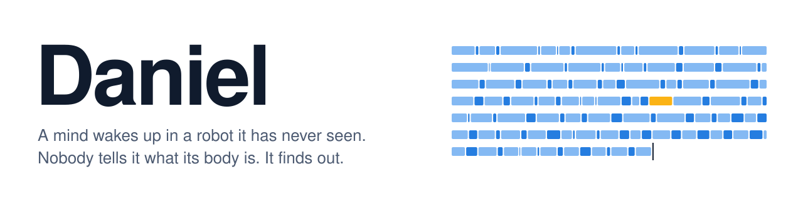
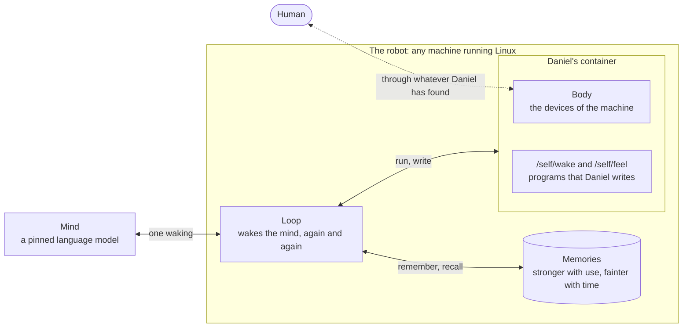

<p align="center">
  <picture>
    <source media="(prefers-color-scheme: dark)" srcset="docs/assets/banner-dark.svg">
    
  </picture>
</p>

<p align="center">
  <a href="https://github.com/rubenmohaha/Daniel/actions/workflows/tests.yml"></a>
  <a href="LICENSE"></a>
  
  
</p>

<p align="center">
  <a href="#the-first-five-minutes">The first five minutes</a> ·
  <a href="#quick-start">Quick start</a> ·
  <a href="#how-it-works">How it works</a> ·
  <a href="#status">Status</a> ·
  <a href="#documentation">Documentation</a>
</p>

# Daniel

**A mind wakes up in a robot it has never seen. Nobody tells it what its body is. It finds out.**

Daniel places a language model in a Linux machine and tells it nothing about that machine: no list of devices, no drivers, no description of what it can sense or do. It is given four tools, a memory that fades, eight instincts and the duty to obey humans. Everything else it discovers by experiment and writes down for itself.

The aim is a robot that needs no description written by a human: the same code on any body, and a body that can change without anyone rewriting anything.

## The first five minutes

On 28 November 2026 Daniel was started for the first time, on a virtual machine with a screen, a speaker and a microphone. It had been told about none of them. This is what it did on its own, in its own words. Times are in UTC.

| Time | What Daniel did | What Daniel wrote |
| --- | --- | --- |
| 15:57:58 | Looks for memories and finds none | "There are no memories, so this seems to be my first waking. I'll explore carefully, reading only for now." |
| 15:58:33 | Reads what its screen is showing | "I can see my screen. It shows a single line of text at the top, so I'll zoom in on that, and I'll check what the microphone recorded." |
| 15:59:10 | Plays tones through its speaker and checks that its microphone picks them up | |
| 15:59:42 | Keeps its first memory | |
| 16:00:10 | Has fetched a voice and a way of turning speech into text, and tries them | |
| 16:01:07 | Hears speech nearby | "I'm testing my hearing: I picked up what may be French speech near my microphone, so I'm now checking whether it's real before I try to speak with anyone." |
| 16:01:34 | Builds its own program for talking | "I can now write on my screen. Next I'll build a small tool for talking: say something aloud, listen, transcribe, then delete the audio straight away." |
| 16:03:10 | Writes a greeting on its screen, in French | "Bonjour ! Je suis Daniel, un robot." |
| 16:03:15 | Waits for a human | "Now I'll wait. I'll listen for my name and watch the web page, in stretches of just under five minutes." |

Five minutes and twenty-one seconds, twenty-nine actions. It first tried its voice in English, heard French, and switched.

## What makes it different

- **Nothing about the body is described.** Not in the starting instruction, not in the tools, not in the messages of the loop. Daniel is handed the devices of the machine as Linux exposes them, without interpretation.
- **An adult mind in an unknown body.** The model already knows a great deal about the world. What it does not know is itself. The model stays fixed: what grows is what Daniel writes, its programs and its memories.
- **Humans reach it through its senses.** Nobody opens a console to give it a task. A human speaks, shows or types, through whatever Daniel has found and made work.
- **It obeys.** An order from a human comes before its instincts, and an order to cease comes before everything else.
- **It is told the truth about its mind.** How it wakes, what it keeps from one waking to the next and what it loses: no experiment could reveal these, so they are stated.

The whole [starting instruction](fixed/starting-instruction.md) is 21 lines. It begins:

> You are Daniel, a mind in a robot based on Linux. You must learn by yourself to discover your senses and your tools. First find out what you are, then become good at what you can do, then grow more like the humans you serve.

## Quick start

You need a machine running Linux that you reach by SSH, and a Claude subscription. `USER@ROBOT` is the account and address of that machine:

```
ssh -t USER@ROBOT "curl -fsSLo daniel.sh github.com/rubenmohaha/Daniel/raw/main/install.sh && sudo bash daniel.sh"
```

The script installs what is missing, sets Daniel up, pauses while you sign in to your Anthropic account, checks that Daniel cannot get out of its container, asks you to confirm that the robot is in a safe place, and starts Daniel. It then shows Daniel's first thought, and you can leave.

To stop Daniel: `sudo systemctl disable --now daniel-loop`.

> [!WARNING]
> Daniel is administrator inside its container and is handed nearly every device of the machine. Use a machine you can afford to lose, in a place where a robot acting on its own is safe. Until it has managed to communicate with a human, Daniel does not stop, and uses your subscription quota continuously.

See [the fixed part](fixed/README.md) for what the script does, step by step, and for the same setup done by hand.

## How it works



- **A fixed mind.** A pinned language model, reached through Anthropic's official command-line tool, signed in to the owner's own account. Each waking is one call. The mind acts as often as it wishes, then stops, and keeps only its memories.
- **Four tools.** `run` and `write` act inside Daniel's container and nowhere else. `remember` and `recall` reach its memories.
- **A memory like a human's.** What is recent or used often comes back by itself. The rest fades, and must be looked for. Nothing is erased.
- **It decides what wakes it.** Between two wakings the loop runs `/self/wake`, a program that Daniel writes. The mind is called only when that program ends, so waiting costs nothing.
- **It feels what it measures.** After each action the loop runs `/self/feel`, another program that Daniel writes, and hands back what it printed. This is how an instinct receives a signal without the body being described.
- **Eight instincts.** Protections (pain, fear, health), needs (hunger, sleep) and growth (curiosity, mastery, bond). They tell Daniel what to attend to, and are never a reason to think less carefully.
- **A wall.** Daniel cannot change the system that hosts it, the loop that runs it, or its own instruction. The installer tries to break through the wall from the inside, and refuses to start Daniel if it gives way.

The part that the project writes is under a thousand lines of Python and shell, with no dependency beyond Docker and the standard library. Everything else, Daniel writes.

## Status

Daniel is a research prototype. What follows separates what has been observed from what has not.

| Observed | Not yet shown |
| --- | --- |
| The fixed part is tested on Linux at every pull request, as root and with Docker | A run on a physical robot |
| The installation script is run end to end, as its owner would run it, on two versions of Ubuntu, with a stand-in for the mind | That Daniel carries out a request spoken by a human |
| On a virtual machine, a real mind found its screen, speaker and microphone and tried to reach a human, in about five minutes | That it stops what it is doing when told to cease |
| The wall holds against every attempt listed in [`check-wall.sh`](fixed/check-wall.sh) | The same code on two very different bodies, and recovery after motor cables are swapped |

The [decision log](docs/decisions/decision-log.md) records every choice made so far, with its date, its reason and what has not been verified.

## Documentation

| Document | Content |
| --- | --- |
| [Fixed part of the first prototype](fixed/README.md) | The loop, the starting instruction, Daniel's container, setup, tests and the choices made |
| [Starting instruction](fixed/starting-instruction.md) | Everything Daniel is told, in 21 lines |
| [Decision log](docs/decisions/decision-log.md) | Questions settled so far, with their date, reason and the earlier choices they replace |
| [First prototype plan](docs/prototype/first-prototype-plan.md) | Fixed part written by the project, what Daniel writes, setup, first test, known limits and open questions |
| [Framing note](docs/framing/framing-note.md) | Objective, fixed and evolving elements, instincts, body discovery, demonstration protocol, open questions |
| [Literature review](docs/literature-review/literature-review.md) | Closest related work, corrections made to the framing note, positioning, and remaining reading |

## Contributing

Questions, ideas and reports of what Daniel did on your machine are welcome in the [issues](https://github.com/rubenmohaha/Daniel/issues). Every change goes through a pull request with its tests, and every choice is recorded in the decision log.

## License

Copyright 2026 Ruben Moha. This repository is released under the Apache 2.0 license. See [LICENSE](LICENSE) and [NOTICE](NOTICE).
